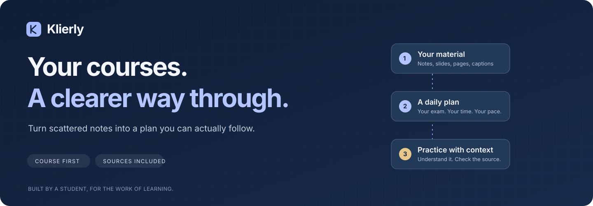
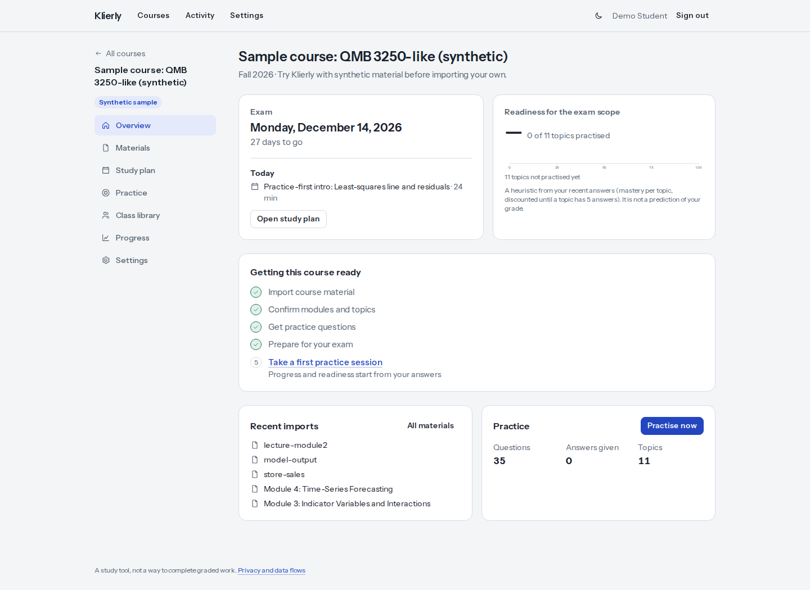
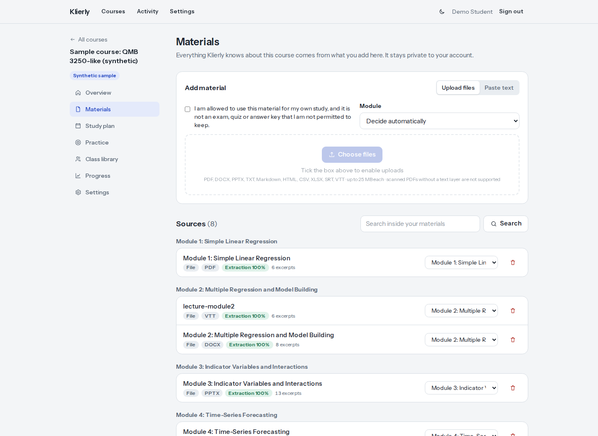
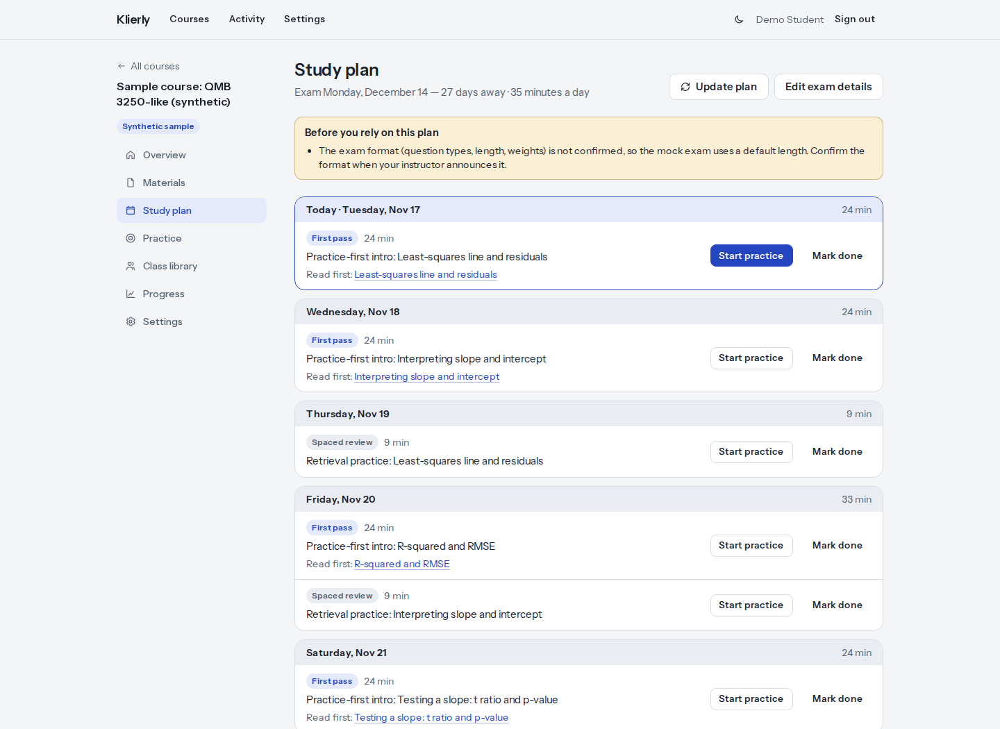
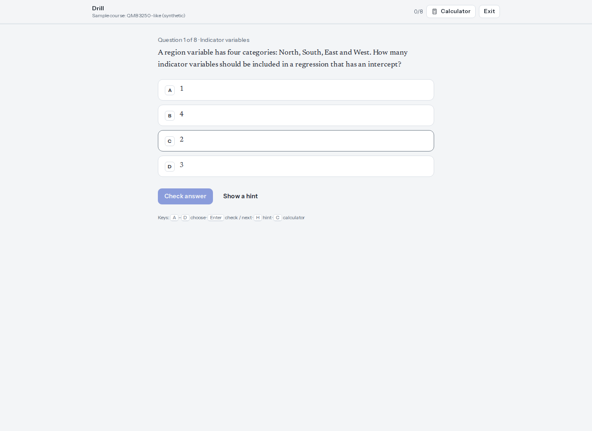

<p align="center">
  
</p>

<p align="center">
  <strong>A study workspace built around your actual course material.</strong><br />
  Bring your notes together, make a realistic plan, and practice with sources you can check.
</p>

<p align="center">
  <a href="https://klierly.klierapps.tech">Visit Klierly</a> ·
  <a href="#a-look-inside">Screenshots</a> ·
  <a href="#try-it">Get started</a> ·
  <a href="ROADMAP.md">Roadmap</a> ·
  <a href="https://www.buymeacoffee.com/gklier">Buy me a coffee ↗</a>
</p>

<p align="center">
  
  
  
  
</p>

## The idea

Course content lives everywhere: a syllabus, a stack of slides, lecture captions, a dozen Canvas pages, and your own notes. Figuring out **what to study today** can become another assignment.

Klierly gives that material a home. It connects the course structure to your exam date and available time, then helps you work through it with practice, feedback, and references back to the original material.

**The goal:** make studying feel manageable—and make it easier to understand *why* an answer is right.

Built by [Gabriel Klier](https://github.com/gklier), starting with the needs of a real student. The name is a play on **Klier / clear**.

## What you can do

| Bring it together | Turn it into a routine | Learn with context |
| --- | --- | --- |
| Upload notes, slides, documents and captions | Build a daily plan around an exam and a time budget | Drill questions or take a timed mock exam |
| Search your course material and open exact excerpts | Review suggested modules, objectives and dates before accepting them | See explanations and references to the original source |
| Preview and selectively import permitted Canvas pages with the extension | Rework the schedule as you practice and miss days | Track topic mastery and the reasons behind mistakes |

- **Take your course with you.** Download originals, readable extracted text, notes, questions and course structure in one ZIP, with an index and a study prompt for another tool. [Course exports →](docs/COURSE_EXPORT.md)
- **Study on your phone.** Short, saved rounds combine recall, recognition, explanations in your own words, and application questions. Flashcards work from existing course references; recent misses return from another angle.
- **Useful with or without AI.** Import, search, planning, and practice on existing questions work without a provider. The synthetic sample includes **35 checked questions**.
- **Optional course-grounded AI.** Generate questions and study notes using an operator-configured allowance or your own supported provider. Availability depends on configuration; a model subscription alone is not an API key.
- **Clear boundaries.** AI-added background explanations are marked separately from course sources. Readiness is a heuristic, not a promised grade.
- **Private accounts.** Account approval, passkey sign-in, revocable extension pairing, and administrator controls are built in. Files and original course text remain private to the account; class summary sharing requires separate approval and consent.

## A look inside

These are real application screenshots using the **synthetic sample course** in an isolated environment. No student records or instructor-owned material are shown. The demo AI connection is a test provider; it is not evidence of real-model quality or an included production allowance.

### One place for the whole course



### A searchable home for your material



### A plan that fits the time you have



### Guided Learn Mode

Open **Learn** inside a course, choose one or two modules, and build a guide from your imported material. The guide provides lessons, guided questions, and saved progress. New builds use your AI allowance and respect the course AI setting. The hosted preview focuses on conceptual questions. **Practice** remains available for calculations.

### Practice that stays connected to the course



## Try it

**Hosted preview:** [klierly.klierapps.tech](https://klierly.klierapps.tech). Request an account by emailing [gabriel.klier@ufl.edu](mailto:gabriel.klier@ufl.edu). Approved users receive a private, single-use enrollment link and create a passkey. Use a browser and device that support your passkey provider; cross-browser compatibility is still being worked through.

After signing in, choose **Load the sample course** to explore without importing personal material or configuring AI.

**Self-host:** start with [the setup guide](docs/SELF_HOSTING.md). For an existing installation, read [account migration and security operations](docs/SECURITY_OPERATIONS.md) before updating. [Cloudflare Tunnel deployment](docs/DEPLOY_CLOUDFLARE.md) is documented separately.

```bash
git clone https://github.com/gklier/Klierly.git
cd Klierly
cp .env.example .env
# Set the required secrets and your final APP_URL before starting.
docker compose up -d --build
```

A fresh installation also needs its first administrator provisioned from the trusted server console; the setup guide covers that step. Public registration and password sign-in are disabled.

### Bring permitted course pages with you

The optional browser extension offers single-page capture, multi-page course discovery, selective import, stop/resume, and supported lecture captions. It previews what will be sent and requests site access when needed.

It does not use a Canvas API key or try to bypass locked content. Active assessments, grades, rosters, and unsupported items are excluded by checks that have limits. Import only material you are permitted to use. Klierly is an independent project, with no university or LMS endorsement.

[Install and use the extension →](extension/README.md) · [Access model and limitations →](docs/LMS_ACCESS.md)

## Built to grow carefully

This is an **early product preview**. The core workflow is implemented and tested; real-course quality, browser compatibility, and operational reliability still need pilot feedback. OCR, official Canvas OAuth, mobile apps, and billing are not shipped.

The ambition is a sustainable study product. Potential paid offerings include convenient hosted access and clearly limited AI allowances. Pricing and plans are undecided; nothing in this repository promises unlimited AI or a permanently free hosted service. [Product direction and commercial plans →](docs/PRODUCT_DIRECTION.md)

If the project is useful—or you want to help fund hosting, AI experiments, and continued development—[**buy me a coffee**](https://www.buymeacoffee.com/gklier). Support is optional and does not purchase an account, subscription, or promised feature.

## For builders

| Component | What it handles |
| --- | --- |
| [`web/`](web/) | Next.js, TypeScript, PostgreSQL, account access, study workflows and provider connections |
| [`worker/`](worker/) | Python document parsing and numerical checks |
| [`extension/`](extension/) | Course discovery, page capture, captions and pairing |
| [`fixtures/`](fixtures/) | Synthetic sample materials and test cases |

The latest security release passed **195 tests**: 106 application, 46 browser, 26 worker, and 17 extension tests. Real-hostname WebAuthn enrollment and login were also checked. This is a recorded validation result, not a guarantee that every future commit passes.

[Architecture](ARCHITECTURE.md) · [Development and tests](docs/DEVELOPMENT.md) · [Security operations](docs/SECURITY_OPERATIONS.md) · [Known issues](docs/KNOWN_ISSUES.md) · [Roadmap](ROADMAP.md)

## Feedback, security, and source terms

Found a usability problem or have a feature idea? [Open an issue](https://github.com/gklier/Klierly/issues). Please use synthetic examples and remove account tokens, private course text, and personal details.

For a suspected security issue, **do not post exploit details or secrets publicly**. See [SECURITY.md](SECURITY.md) for private reporting.

**Public source preview.** No open-source license has been selected. Publishing the source does not grant a license to redistribute it, sell it, or run a competing hosted service. Licensing and outside contributions need an explicit agreement; dependency licenses remain their own. See [source terms](SOURCE_TERMS.md).

<p align="center"><sub>Less time organizing the work. More time understanding it.</sub></p>
